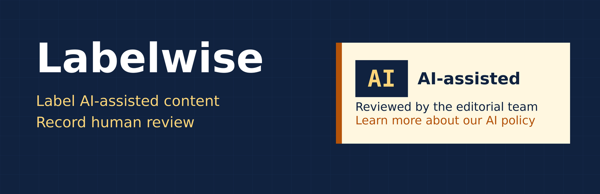

# Labelwise — AI disclosure labels for WordPress

**Label AI-assisted and AI-generated content, record human review, and show a clear disclosure badge on your posts and pages.**

The EU AI Act's Article 50 transparency obligations have applied since **2 August 2026**. Labelwise helps WordPress publishers be open about how AI is used — one label per post, chosen by a human.

> Labelwise helps you show and document what you disclose. It is **not legal advice** and does not guarantee compliance.

## Features (free)

- AI disclosure box in the editor for posts, pages and any public post type
- Four states: `none`, `ai_assisted`, `ai_generated`, `human_reviewed`
- Accessible badge above or below the content, or anywhere with `[labelwise_badge]`
- Light and dark styles, your own wording for every label
- Optional “Reviewed by” name and date, and a link to your AI policy page
- AI label column in content lists and a site-wide overview
- No tracking, no external requests

## Labelwise Pro

- **Publishing gate** — AI-labelled content is held as *Pending* until an editor marks it human-reviewed
- **Review log** — who changed which label, from what, to what, and when
- **Machine-readable markers** — `<meta name="labelwise:ai-disclosure">`, a `labelwise` REST API field and a `<labelwise:status>` RSS element
- **Chatbot notice** shortcode `[labelwise_chatbot_notice]`
- **AI-use policy page** generator

👉 **[Try the interactive demo and get Pro](https://labelwise-pro.pages.dev/)** — from $49/year, 30-day money-back guarantee.

## Install

1. In WordPress, go to **Plugins → Add New** and search for **Labelwise**, or download it from [WordPress.org](https://wordpress.org/plugins/labelwise/).
2. Activate it, then open **Settings → Labelwise**.
3. Choose a label in the editor sidebar of any post.

Requires WordPress 6.2+ and PHP 7.4+.

## FAQ

**Does it detect AI-written text?** No. You choose the label. Nothing is analysed or sent anywhere.

**Does it work with block themes and page builders?** Yes — the badge is added to the content and is also available as a shortcode.

## License

GPL v2 or later. See [LICENSE](LICENSE).

---

`wordpress` `wordpress-plugin` `ai` `ai-act` `ai-transparency` `ai-disclosure` `content-labeling` `editorial-workflow`
